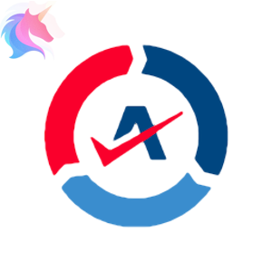

<h1 align="center">
  <br>
  <a href="https://celerium.org"></a>
  <br>
  Celerium.AutoTask
  <br>
</h1>

[![CI][CI-shield]][CI-url]
[![GitHub_Pages][GitHub_Pages-shield]][GitHub_Pages-url]

[![PoshGallery_Version][PoshGallery_Version-shield]][PoshGallery_Version-url]
[![PoshGallery_Platforms][PoshGallery_Platforms-shield]][PoshGallery_Platforms-url]
[![PoshGallery_Downloads][PoshGallery_Downloads-shield]][PoshGallery_Downloads-url]
[![codeSize][codeSize-shield]][codeSize-url]

[![Contributors][contributors-shield]][contributors-url]
[![Forks][forks-shield]][forks-url]
[![Stargazers][stars-shield]][stars-url]
[![Issues][issues-shield]][issues-url]

[![GitHub_License][GitHub_License-shield]][GitHub_License-url]

<a name="readme-top"></a>

<!-- PROJECT LOGO -->
<br />
<div align="center">
  <a href="https://celerium.org">
    
  </a>

  <p align="center">
    <a href="https://www.powershellgallery.com/packages/Celerium.AutoTask" target="_blank">PowerShell Gallery</a>
    ·
    <a href="https://github.com/Celerium/Celerium.AutoTask/issues/new/choose" target="_blank">Report Bug</a>
    ·
    <a href="https://github.com/Celerium/Celerium.AutoTask/issues/new/choose" target="_blank">Request Feature</a>
  </p>
</div>

---

## Buy me a coffee

Whether you use this project, have learned something from it, or just like it, please consider supporting it by buying me a coffee, so I can dedicate more time on open-source projects like this :)

<a href="https://www.buymeacoffee.com/Celerium" target="_blank"></a>

## Thanks

Big thanks to Kelvin Tegelaar [AutotaskAPI](https://github.com/KelvinTegelaar/AutotaskAPI) for being the basis of what I used to create this module. I have learned a lot from his work and it has been a great help in understanding how to interact with AutoTask and API's overall.

## About The Project

The [Celerium.AutoTask](https://www.powershellgallery.com/packages/Celerium.AutoTask) PowerShell wrapper offers the ability to read, create, update, & delete the data within AutoTask's (Datto|Autotask PSA) platform. This gives system administrators and PowerShell developers a convenient and familiar way of using AutoTask's REST API to create documentation scripts, automation, and integrations.

- :book: **Celerium.AutoTask** project documentation can be found on [Github Pages](https://celerium.github.io/Celerium.AutoTask/)
- :book: AutoTask's REST API documentation can be found [here](https://www.autotask.net/help/developerhelp/Content/APIs/REST/REST_API_Home.htm)

The AutoTask API has almost 400 resources & more than 3,000 operations. Instead of one function per endpoint the module has a few **generic functions** that support every resource & operation of the AutoTask OpenAPI (swagger) spec:

|Method                       |Function                  |Description                                                       |
|-----------------------------|--------------------------|------------------------------------------------------------------|
|GET (& POST query / count)   |`Get-AutoTaskResource`    |Get a resource by ID, with a search query, or the children of a parent |
|POST                         |`New-AutoTaskResource`    |Create a resource                                                 |
|PATCH (& PUT)                |`Set-AutoTaskResource`    |Update a resource                                                 |
|DELETE                       |`Remove-AutoTaskResource` |Delete a resource                                                 |
|GET                          |`New-AutoTaskBody`        |Create a body template from the field definitions of a resource   |
|                             |`Show-AutoTaskResource`   |List the resources, operations, methods, & paths                  |

The `-Resource` parameter is validated & **tab-completed** from the spec, only the resources that a function supports are suggested (for example only the resources that can be deleted for `Remove-AutoTaskResource`). The `-Operation` parameter selects the other operations of a resource, such as `QueryCount` or `QueryInvoicePdf`.

```posh
Get-AutoTaskResource -Resource Companies -ID 12345
Get-AutoTaskResource -Resource Companies -SimpleSearch 'isActive eq true'
Get-AutoTaskResource -Resource CompanyAlertsChild -ID 12345     # every alert of company 12345
```

### Write functions

`New-AutoTaskResource`, `Set-AutoTaskResource`, & `Remove-AutoTaskResource` change data in AutoTask. They support `-WhatIf`, ask for confirmation before a request is sent (`ConfirmImpact` High), and a failed write request is **never retried**. Use `-Confirm:$false` in scripts after testing them with `-WhatIf`.

```posh
# Shows the request that would be sent, nothing is sent
Set-AutoTaskResource -Resource Companies -ID 12345 -Data @{ phone = '555-555-5555' } -WhatIf
```

<p align="right">(<a href="#readme-top">back to top</a>)</p>

## Install

This module can be installed directly from the [PowerShell Gallery](https://www.powershellgallery.com/packages/Celerium.AutoTask) with the following command:

```posh
Install-Module -Name Celerium.AutoTask
```

- :information_source: This module supports Windows PowerShell 5.1 and PowerShell 7+ on Windows, Linux, & macOS.
- :information_source: If PowerShellGet is unavailable, download the release archive from GitHub and place the *Celerium.AutoTask* folder in one of the folders listed in `$env:PSModulePath`.

- A full list of functions can be retrieved by running `Get-Command -Module Celerium.AutoTask`.
- Help info and a list of parameters can be found by running `Get-Help <command name>`, such as:

```posh
Get-Help Get-AutoTaskResource -Full
```

<p align="right">(<a href="#readme-top">back to top</a>)</p>

## Initial Setup

After installing this module, you will need to configure the *API user* that is used to talk with the AutoTask API. An API user is created in AutoTask under *Admin > Resources (Users) > New API User*, the API tracking identifier of the API user is the **integration code**.

1. Run `Add-AutoTaskAPIKey -ApiUsername 'api@example.com' -ApiIntegrationCode '12345'`
   - It will prompt you to enter the API secret if you do not specify it with `-ApiSecretKey` or `-ApiKeySecureString`

2. Run `Add-AutoTaskBaseURI` or `Add-AutoTaskBaseURI -DataCenter 'America West 3'`
   - `Add-AutoTaskBaseURI` detects your AutoTask zone from the API username (one unauthenticated request)
   - If you have your own API gateway or proxy, use the `-BaseURI` parameter: `Add-AutoTaskBaseURI -BaseURI https://myapi.gateway.celerium.org`

3. Run `Test-AutoTaskAPIKey` to verify the values with a single read-only request

4. [**optional**] Run `Export-AutoTaskModuleSettings`
   - This will create a config file at `%UserProfile%\Celerium.AutoTask` that holds the *base uri* & *API* information, which is loaded the next time the module is imported.
   - :warning: The API secret & integration code are encrypted with the Windows Data Protection API (DPAPI) and can **only be decrypted by the user** that encrypted them on the same computer.
   - :warning: On Linux & macOS the values are NOT encrypted, use the environment variables below or a secret store instead.

The module also reads the following environment variables when it is imported (they take precedence over the config file), which is the recommended setup for CI\CD, Linux, & macOS:

|Variable                         |Description                                                          |
|---------------------------------|---------------------------------------------------------------------|
|`AUTOTASK_BASE_URI`              |Optional, the zone url such as `https://webservices24.autotask.net/atservicesrest` |
|`AUTOTASK_API_USERNAME`          |The username of the API user                                         |
|`AUTOTASK_API_SECRET`            |The secret of the API user                                           |
|`AUTOTASK_API_INTEGRATION_CODE`  |The API integration code (tracking identifier) of the API user       |

<p align="right">(<a href="#readme-top">back to top</a>)</p>

## Usage

```posh
# Get the resources that support GET requests
Show-AutoTaskResource -Method GET -UniqueOnly

# Get a company by ID & the first 500 active companies
Get-AutoTaskResource -Resource Companies -ID 0
Get-AutoTaskResource -Resource Companies -SimpleSearch 'isActive eq true'

# Get every active company, 500 at a time
Get-AutoTaskResource -Resource Companies -SimpleSearch 'isActive eq true' -AllResults

# Advanced search & count queries
Get-AutoTaskResource -Resource Tickets -AdvancedSearch '{"MaxRecords":10,"filter":[{"op":"gte","field":"createDate","value":"2026-01-01"}]}'
Get-AutoTaskResource -Resource Tickets -SimpleSearch 'status eq 1' -Operation QueryCount

# Child resources use the parent ID with -ID & the child ID with -ChildID
Get-AutoTaskResource -Resource CompanyNotesChild -ID 12345
Get-AutoTaskResource -Resource CompanyNotesChild -ID 12345 -ChildID 67

# Other operations of a resource
Get-AutoTaskResource -Resource InvoiceMarkupApiIntegration -ID 12345 -Operation QueryInvoicePdf
Get-AutoTaskResource -Resource ThresholdApiIntegration

# Create a body template, then create, update, & delete (each asks for confirmation)
$Body = New-AutoTaskBody -Resource Companies -Empty
New-AutoTaskResource -Resource Companies -Data $Body
Set-AutoTaskResource -Resource Companies -ID 12345 -Data @{ phone = '555-555-5555' }
Remove-AutoTaskResource -Resource CompanyNotesChild -ID 12345 -ChildID 67
```

- Example scripts can be found in the [examples](https://github.com/Celerium/Celerium.AutoTask/tree/main/examples) folder of this repository.

### Supported functions

|Category|EndpointUri              |Method|Function                |Example                    |
|--------|-------------------------|------|------------------------|---------------------------|
|Resource|See Show-AutoTaskResource|GET   |Get-AutoTaskResource    |Invoke-CompanyReportExample|
|Resource|See Show-AutoTaskResource|GET   |New-AutoTaskBody        |Invoke-CompanyReportExample|
|Resource|See Show-AutoTaskResource|POST  |New-AutoTaskResource    |N/A                        |
|Resource|See Show-AutoTaskResource|DELETE|Remove-AutoTaskResource |N/A                        |
|Resource|See Show-AutoTaskResource|PATCH |Set-AutoTaskResource    |N/A                        |
|Resource|                         |GET   |Show-AutoTaskResource   |N/A                        |

### Upgrading from 1.x

Version 2.0.0 keeps the generic functions & their parameters, but the following changes can affect existing scripts:

- `New-AutoTaskResource` & `Set-AutoTaskResource` now use `ConfirmImpact` High like `Remove-AutoTaskResource`, so they ask for confirmation. Add `-Confirm:$false` to unattended scripts.
- The `-Resource` parameter is a normal parameter with tab-completion instead of a dynamic parameter with a `ValidateSet`. The resource names are the same. Resources that did not work in 1.x (child resources, resources such as `OrganizationalLevel1` whose path differs from their name, & resources with special operations) now work.
- The internal `New-AutoTaskResourceDynamicParameter` & `Set-AutoTaskResourceDynamicParameter` functions and the global `AutoTaskModuleSwagger`, `AutoTaskModuleQueries`, & `AutoTaskModule*Parameter` variables were removed. The spec is no longer converted when the module is imported, which makes the import several seconds faster.
- `Add-AutoTaskBaseURI` no longer makes a web request to look up the API version every time it runs, `-Version` defaults to `V1.0`. A base uri that ends with an API version is accepted.
- `Set-AutoTaskResource -ID` now adds the ID to the request body (it was ignored before).
- `New-AutoTaskResource` returns the response (`itemId`) of the API, which was not returned before.
- `Get-AutoTaskResource` without `-ID` or a search queries every item of a resource (the first 500 unless `-AllResults` is used).
- `Export-AutoTaskModuleSettings` encrypts the integration code. Config files created by 1.x are still imported.
- The `-Operation` & `-Raw` parameters are new.

<p align="right">(<a href="#readme-top">back to top</a>)</p>

### Development

The module is built from the files in this repository with the scripts in the [build](https://github.com/Celerium/Celerium.AutoTask/tree/main/build) folder. The same steps are run by the GitHub Actions workflows in [.github/workflows](https://github.com/Celerium/Celerium.AutoTask/tree/main/.github/workflows).

|Script                        |Description                                                                                              |
|------------------------------|---------------------------------------------------------------------------------------------------------|
|Install-Prerequisites.ps1     |Installs the latest ModuleBuilder, Pester, Microsoft.PowerShell.PlatyPS, & PSScriptAnalyzer              |
|New-AutoTaskResourceMap.ps1   |Creates the resource map (`Private/ApiCalls/Get-AutoTaskResourceMap.ps1`) from the spec in the module folder |
|Get-AutoTaskSpec.ps1          |Downloads the online spec & saves it as `Celerium.AutoTask/AutoTaskAPI-<yyyy.M>.json`                    |
|Compare-AutoTaskSpec.ps1      |Compares the newest local spec with the online spec & optionally updates it                              |
|Invoke-ModuleBuild.ps1        |Builds the module & copies the spec into `build/Celerium.AutoTask/<version>`                             |
|Invoke-PesterTests.ps1        |Runs the Pester tests against the source or built module                                                 |
|Invoke-HelpContent.ps1        |Regenerates the GitHub pages documentation in `docs` with Microsoft.PowerShell.PlatyPS                   |
|Publish-CeleriumModule.ps1    |Publishes the built module to the PowerShell Gallery                                                     |

The AutoTask OpenAPI spec is the known exception of the Celerium projects that is stored in the module folder (`Celerium.AutoTask/AutoTaskAPI-2023.6.json`) instead of the `docs` folder. It is part of the built module.

```posh
./build/Install-Prerequisites.ps1
./build/Invoke-ModuleBuild.ps1 -Version 2.0.0
./build/Invoke-PesterTests.ps1 -Version 2.0.0 -BuildTarget built
```

To support a newer version of the API, run `./build/Compare-AutoTaskSpec.ps1` to see what changed in the online spec (<https://webservices24.autotask.net/ATServicesRest/swagger/docs/v1>, no authentication required). Run `./build/Get-AutoTaskSpec.ps1` to download it (or `./build/Compare-AutoTaskSpec.ps1 -UpdateLocal`, the old file is first copied to `build/Archive`), then run `./build/New-AutoTaskResourceMap.ps1`. The CI workflow fails when the resource map does not match the spec.

**Live tests** make real, read-only requests (GET requests & POST queries). They are excluded unless the following environment variables are set and the `Live` tag is included:

```posh
$env:AUTOTASK_API_USERNAME          = 'api@example.com'
$env:AUTOTASK_API_SECRET            = 'your-secret'
$env:AUTOTASK_API_INTEGRATION_CODE  = 'your-integration-code'
./build/Invoke-PesterTests.ps1 -Version 2.0.0 -IncludeTag Live -ExcludeTag Online
```

<p align="right">(<a href="#readme-top">back to top</a>)</p>

---

## Contributing

Contributions are what makes the open-source community such an amazing place to learn, inspire, and create. Any contributions you make are **greatly appreciated**.

If you have a suggestion that would make this better, please fork the repo and create a pull request. You can also simply open an issue with the tag "enhancement".
Don't forget to give the project a star! Thanks again!

See the [CONTRIBUTING](https://github.com/Celerium/Celerium.AutoTask/blob/main/.github/CONTRIBUTING.md) guide for more information about contributing.

<p align="right">(<a href="#readme-top">back to top</a>)</p>

## License

Distributed under the MIT license. See [LICENSE](https://github.com/Celerium/Celerium.AutoTask/blob/main/LICENSE) for more information.

[![GitHub_License][GitHub_License-shield]][GitHub_License-url]

<p align="right">(<a href="#readme-top">back to top</a>)</p>

<!-- MARKDOWN LINKS & IMAGES -->
<!-- https://www.markdownguide.org/basic-syntax/#reference-style-links -->

[CI-shield]:                        https://img.shields.io/github/actions/workflow/status/Celerium/Celerium.AutoTask/ci.yml?style=for-the-badge&label=CI
[CI-url]:                           https://github.com/Celerium/Celerium.AutoTask/actions/workflows/ci.yml

[GitHub_Pages-shield]:              https://img.shields.io/github/actions/workflow/status/celerium/Celerium.AutoTask/pages%2Fpages-build-deployment?style=for-the-badge&label=GitHub%20Pages
[GitHub_Pages-url]:                 https://github.com/Celerium/Celerium.AutoTask/actions/workflows/pages/pages-build-deployment

[GitHub_License-shield]:            https://img.shields.io/github/license/celerium/Celerium.AutoTask?style=for-the-badge
[GitHub_License-url]:               https://github.com/Celerium/Celerium.AutoTask/blob/main/LICENSE

[PoshGallery_Version-shield]:       https://img.shields.io/powershellgallery/v/Celerium.AutoTask?include_prereleases&style=for-the-badge
[PoshGallery_Version-url]:          https://www.powershellgallery.com/packages/Celerium.AutoTask

[PoshGallery_Platforms-shield]:     https://img.shields.io/powershellgallery/p/Celerium.AutoTask?style=for-the-badge
[PoshGallery_Platforms-url]:        https://www.powershellgallery.com/packages/Celerium.AutoTask

[PoshGallery_Downloads-shield]:     https://img.shields.io/powershellgallery/dt/Celerium.AutoTask?style=for-the-badge
[PoshGallery_Downloads-url]:        https://www.powershellgallery.com/packages/Celerium.AutoTask

[codeSize-shield]:                  https://img.shields.io/github/repo-size/celerium/Celerium.AutoTask?style=for-the-badge
[codeSize-url]:                     https://github.com/Celerium/Celerium.AutoTask

[contributors-shield]:              https://img.shields.io/github/contributors/celerium/Celerium.AutoTask?style=for-the-badge
[contributors-url]:                 https://github.com/Celerium/Celerium.AutoTask/graphs/contributors

[forks-shield]:                     https://img.shields.io/github/forks/celerium/Celerium.AutoTask?style=for-the-badge
[forks-url]:                        https://github.com/Celerium/Celerium.AutoTask/network/members

[stars-shield]:                     https://img.shields.io/github/stars/celerium/Celerium.AutoTask?style=for-the-badge
[stars-url]:                        https://github.com/Celerium/Celerium.AutoTask/stargazers

[issues-shield]:                    https://img.shields.io/github/issues/Celerium/Celerium.AutoTask?style=for-the-badge
[issues-url]:                       https://github.com/Celerium/Celerium.AutoTask/issues
